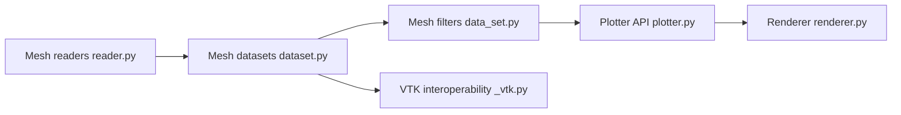

# pyvista/pyvista

> Python library for 3D visualization and mesh analysis, built on VTK, for scientists and engineers.

## The problem
VTK is powerful but its C++ API ported to Python is heavy; manipulating meshes and displaying them in a notebook takes a lot of code.

## What it actually does
Provides NumPy-native data structures (points, surfaces, volumes), filters (clip, slice, threshold, smoothing), and a single plotting framework for notebooks, scripts, CI and apps. A `pyvista` CLI plots, converts and validates meshes. An accessor-based extension API lets third-party packages add filters.

## How it is wired


## Trying it
```bash
pip install pyvista
conda install -c conda-forge pyvista
pyvista plot bunny.stl
pyvista convert bunny.stl .vtp
pyvista validate bunny.stl
```

## Cost and gotchas
Python 3.10+. Interactive rendering requires a graphical display; in CI, headless mode is announced as supported.

## What it is not
Not a real-time rendering engine nor a CAD tool. The README compares itself to pandas for 3D: that is the authors' positioning, not a measurement.

## Alternatives
- VTK: the underlying C++ toolkit, lower level.
- awesome-pyvista: a list of domain tools built on PyVista.

## For you
Adopt for any scientific 3D visualization need in Python (point clouds, meshes): an old project (2017), active, MIT.
