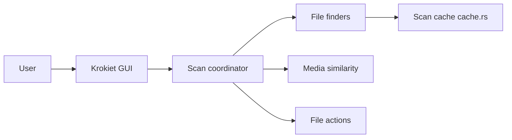

# qarmin/czkawka

> File cleanup suite: duplicates, empty files, similar images and videos, in Rust.

## The problem
Finding the useless or duplicate files that clutter a disk.

## What it actually does
A Rust core (`czkawka_core`) with several frontends: Krokiet (Slint, active), CLI, GTK (discontinued after 12.0) and Cedinia (Android). Tools: duplicates by name, size or hash, empty folders and files, big files, similar images and videos, music, broken links, Exif cleanup. A cache speeds up later scans. No Internet access and no data collection.

## How it is wired

## Trying it
No command documented in the README: download the Krokiet binaries from the releases.

## Cost and gotchas
Free. The GTK interface no longer gets new binaries. Deletion actions touch the file system: check before applying.

## What it is not
Not an ML dataset deduplication tool: it targets disk cleanup. License "present but unidentified" according to GitHub.

## Alternatives
fclones (very fast Rust CLI), rmlint, rdfind (consoles); DupeGuru, FSlint, AntiDupl.NET, Video Duplicate Finder (graphical).

## For you
Ignore unless you occasionally need to free up disk space; fclones is better suited to large volumes on the command line.
