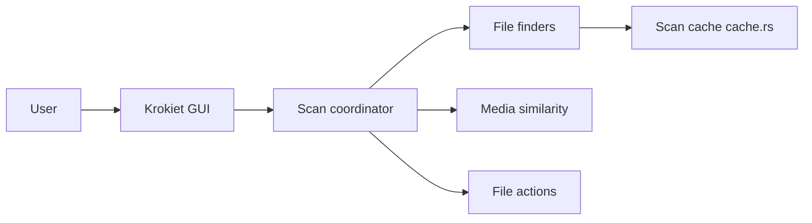

# qarmin/czkawka

> Suite de nettoyage de fichiers : doublons, fichiers vides, images et vidéos similaires, en Rust.

## Le problème
Retrouver les fichiers inutiles ou en double qui encombrent un disque.

## Ce que ça fait vraiment
Un cœur Rust (`czkawka_core`) avec plusieurs frontends : Krokiet (Slint, actif), CLI, GTK (arrêté après la 12.0) et Cedinia (Android). Outils : doublons par nom, taille ou hash, dossiers et fichiers vides, gros fichiers, images et vidéos similaires, musique, liens cassés, nettoyage Exif. Cache pour accélérer les scans suivants. Sans accès à Internet ni collecte de données.

## Comment c'est branché

## Essayer
Aucune commande documentée dans le README : télécharger les binaires de Krokiet depuis les releases.

## Coût et pièges
Gratuit. L'interface GTK n'a plus de nouveaux binaires. Les actions de suppression touchent le système de fichiers : vérifier avant d'appliquer.

## Ce que ce n'est pas
Pas un outil de déduplication de jeux de données ML : il vise le nettoyage de disque. Licence « présente mais non identifiée » par GitHub.

## Alternatives
fclones (CLI Rust très rapide), rmlint, rdfind (consoles) ; DupeGuru, FSlint, AntiDupl.NET, Video Duplicate Finder (graphiques).

## Pour toi
À ignorer sauf besoin ponctuel de faire de la place sur un disque ; fclones est plus adapté aux gros volumes en ligne de commande.

