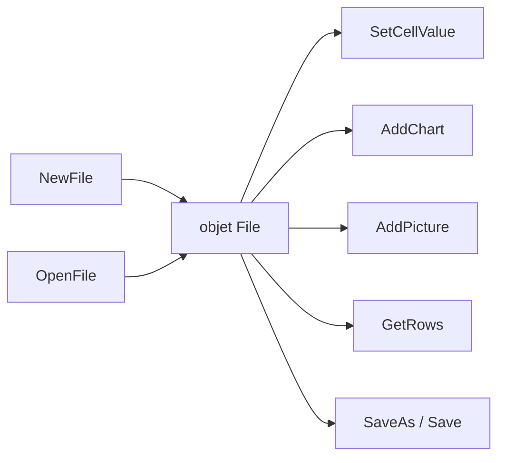

# qax-os/excelize

> Pure Go library for reading and writing Excel XLSX, XLSM workbooks and related templates.

## The problem
Producing a real Excel file from a Go service often means going through an external binary.
And reading a workbook with several hundred thousand rows blows up memory.

## What it actually does
Reads and writes XLAM, XLSM, XLSX, XLTM, XLTX files generated by Excel 2007 and later.
Exposes a streaming API to generate or read a sheet containing a lot of data.
Handles charts (`AddChart`, with series, categories, rich title) without any prior data in the sheet.
Inserts PNG, JPEG, GIF images with scaling, in-cell offset, locking and a print option.

## How it is wired


## Trying it
```bash
go get github.com/xuri/excelize/v2
```
Then `excelize.NewFile()`, `f.SetCellValue("Sheet2", "A2", "Hello world.")`, `f.SaveAs("Book1.xlsx")`;
on the reading side, `excelize.OpenFile("Book1.xlsx")` then `f.GetCellValue` or `f.GetRows`.

## Cost and gotchas
Requires Go 1.26 or newer. The import path is `github.com/xuri/excelize/v2` while the
repository is published under `qax-os`: don't get confused in your modules.

## What it is not
Not a full Excel calculation engine as far as the README goes: it writes and reads files, it does not replace Excel.
Not a CLI tool: it is a Go dependency, you have to write the program around it.
Not usable from Python: all the examples are in Go.

## Alternatives
None named in the README.

## For you
Relevant only if your pipeline has a Go piece; in Python, openpyxl remains your path.
