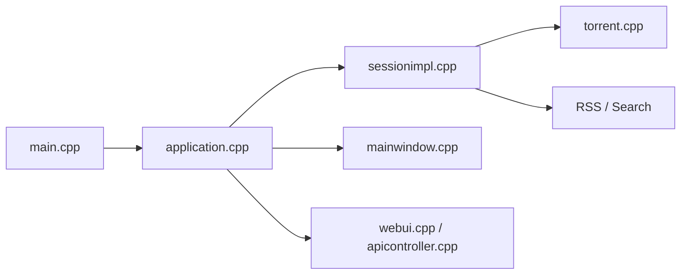

# qbittorrent/qBittorrent

> BitTorrent client in C++/Qt based on libtorrent, with a desktop interface and WebUI.

## The problem
Downloading and sharing via BitTorrent with a free, lightweight, ad-free client.

## What it actually does
The core (`src/base/bittorrent`) wraps libtorrent: session, torrents, trackers, resume. Two modes: Qt Widgets GUI, or `qbittorrent-nox` with a WebUI through an internal HTTP server and a controller-based API. RSS feeds with automatic download, search engine with Python plugins (nova3), Lua plugins.

## How it is wired

## Trying it
The README points to the INSTALL file. No command appears there.

## Cost and gotchas
Free. Binaries and archives signed since 3.3.4 (PGP key given). DB-IP GeoIP database under CC BY 4.0. License not identified by GitHub: to be checked.

## What it is not
Not an anonymous download tool: no privacy feature is described.

## Alternatives
No alternative named in the README.

## For you
Ignore: consumer utility, outside the data/AI scope; check the license before any redistribution.
