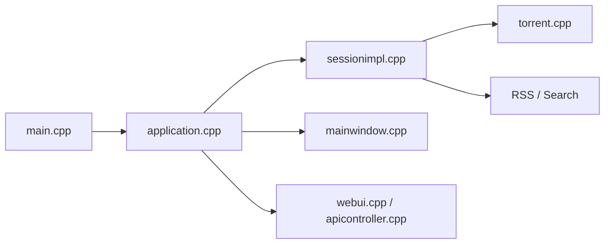

# qbittorrent/qBittorrent

> Client BitTorrent en C++/Qt basé sur libtorrent, avec interface bureau et WebUI.

## Le problème
Télécharger et partager via BitTorrent avec un client libre, léger et sans publicité.

## Ce que ça fait vraiment
Le cœur (`src/base/bittorrent`) enveloppe libtorrent : session, torrents, trackers, reprise. Deux modes : GUI Qt Widgets, ou `qbittorrent-nox` avec WebUI via un serveur HTTP interne et une API à contrôleurs. Flux RSS avec téléchargement automatique, moteur de recherche à plugins Python (nova3), plugins Lua.

## Comment c'est branché

## Essayer
Le README renvoie au fichier INSTALL. Aucune commande n'y figure.

## Coût et pièges
Gratuit. Binaires et archives signés depuis la 3.3.4 (clé PGP indiquée). Base GeoIP de DB-IP sous CC BY 4.0. Licence non identifiée par GitHub : à vérifier.

## Ce que ce n'est pas
Pas un outil de téléchargement anonyme : aucune fonction de confidentialité n'est décrite.

## Alternatives
Aucune alternative nommée dans le README.

## Pour toi
Ignorer : utilitaire grand public, hors périmètre data/IA ; vérifier la licence avant toute redistribution.

