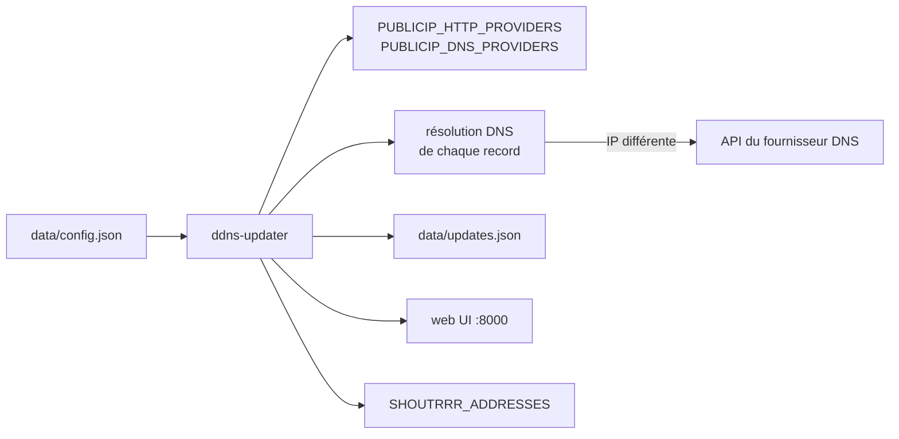

# qdm12/ddns-updater

> Lightweight program that keeps DNS A and AAAA records up to date at many providers.

## The problem
A residential IP changes and the DNS records point into the void.
Each DNS provider has its own API: one script per provider, and the risk of being banned.

## What it actually does
Periodically updates records at about sixty providers (Cloudflare, OVH,
Gandi, Route53, Scaleway, deSEC, DuckDNS, Namecheap, Porkbun, Hetzner…).
Desktop and mobile web interface, notifications via Shoutrrr, persistence of old IPs in `updates.json`.
12 MB Docker image based on Scratch, DNS healthcheck, eight CPU architectures. Dependency-free binaries.
Public IP retrieval by cycling between HTTP and DNS services so as not to get blocked.

## How it is wired


## Trying it
```bash
go install github.com/qdm12/ddns-updater/cmd/ddns-updater@latest
mkdir data && chown 1000 data && chmod u+r+w+x data
docker run -d -p 8000:8000/tcp -v "$(pwd)"/data:/updater/data ghcr.io/qdm12/ddns-updater
docker build -t ghcr.io/qdm12/ddns-updater https://github.com/qdm12/ddns-updater.git
```

## Cost and gotchas
Free; you need an account with the DNS provider and a token in `config.json`, so a secret
in clear text on disk. `UPDATE_COOLDOWN_PERIOD` exists to avoid being banned.
Cloudflare `proxied` case: the comparison is made on the persisted IP, so a manual change
to the record is not detected.

## What it is not
It is not a DNS server or a zone manager: it only touches the IP of existing records.
It is not authenticated: the web UI should be exposed with caution. The README and `docs/` are versioned
by program version, so read the right page.

## Alternatives
None named; the project is integrated elsewhere (Starttoaster/docker-traefik, Home Assistant add-on).

## For you
The right tool if you self-host something behind a dynamic IP. Otherwise irrelevant.
