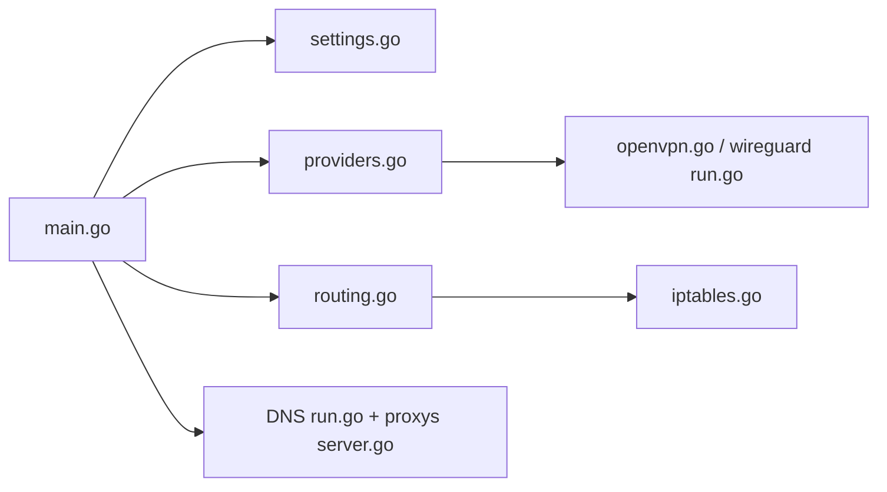

# qdm12/gluetun

> Multi-provider VPN client container with a kill switch, to route other containers through it.

## The problem
Getting containers or machines out of the local network through a VPN, without configuring OpenVPN/WireGuard by hand for each provider.

## What it actually does
Connects to about twenty providers (OpenVPN, WireGuard, AmneziaWG for custom config), sets up a kill switch firewall, and offers DNS over TLS with filtering, SOCKS5/HTTP/Shadowsocks proxies, port forwarding for PIA, PrivateVPN and ProtonVPN. Other containers attach to it.

## How it is wired


## Trying it
```bash
# README : un docker-compose.yml (image qmcgaw/gluetun)
# cap_add: NET_ADMIN, devices: /dev/net/tun, VPN_SERVICE_PROVIDER=ivpn, VPN_TYPE=openvpn
```
The README gives no other command: everything goes through the compose file and the wiki.

## Cost and gotchas
A VPN subscription is required (OpenVPN credentials or WireGuard key). `NET_ADMIN` rights and `/dev/net/tun`. The repository announces a migration to `github.com/passteque/gluetun`; the image names remain.

## What it is not
Not a VPN provider. No official support for Mullvad over OpenVPN (WireGuard only). Single maintainer.

## Alternatives
No alternative named in the README.

## For you
Worth watching: useful for isolating scrapers or data jobs behind a VPN, but outside the core data/AI scope and dependent on one person.
