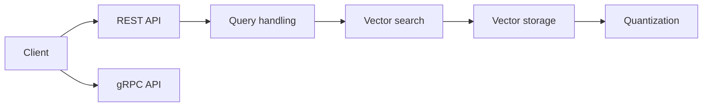

# qdrant/qdrant

> Vector database in Rust, with metadata filtering, for semantic search and RAG.

## The problem
Finding the closest items among millions of embeddings, while filtering on attributes.

## What it actually does
Stores points (a vector plus a JSON payload) and queries them via REST (OpenAPI) or gRPC: dense, sparse and multi-vectors, hybrid search (RRF, DBSF), filters, quantization, on-disk storage, sharding and replication, snapshots. An Edge version runs inside the application process.

## How it is wired


## Trying it
```bash
docker run -p 6333:6333 qdrant/qdrant
```
```python
from qdrant_client import QdrantClient

client = QdrantClient(url="http://localhost:6333")
```

## Cost and gotchas
Free locally. The default container has no authentication and is open on all interfaces: secure it before exposing it. Qdrant Cloud has a free tier; pricing is not detailed.

## What it is not
Not an embedding model: you supply the vectors. The performance figures come from the vendor's benchmarks.

## Alternatives
No alternative named in the README.

## For you
Adopt: a standard building block for RAG and similarity search, easy to launch in Docker with a Python client.
