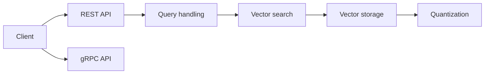

# qdrant/qdrant

> Base de données vectorielle en Rust, avec filtrage sur métadonnées, pour la recherche sémantique et le RAG.

## Le problème
Retrouver les éléments les plus proches parmi des millions d'embeddings, en filtrant sur des attributs.

## Ce que ça fait vraiment
Stocke des points (vecteur plus charge JSON) et les interroge via REST (OpenAPI) ou gRPC : vecteurs denses, creux et multi-vecteurs, recherche hybride (RRF, DBSF), filtres, quantification, stockage sur disque, sharding et réplication, instantanés. Une version Edge s'exécute dans le processus de l'application.

## Comment c'est branché


## Essayer
```bash
docker run -p 6333:6333 qdrant/qdrant
```
```python
from qdrant_client import QdrantClient

client = QdrantClient(url="http://localhost:6333")
```

## Coût et pièges
Gratuit en local. Le conteneur par défaut est sans authentification et ouvert sur toutes les interfaces : à sécuriser avant exposition. Qdrant Cloud a un niveau gratuit ; les tarifs ne sont pas détaillés.

## Ce que ce n'est pas
Pas un modèle d'embedding : tu fournis les vecteurs. Les chiffres de performance viennent des benchmarks de l'éditeur.

## Alternatives
Aucune alternative nommée dans le README.

## Pour toi
À adopter : brique standard pour le RAG et la recherche de similarité, simple à lancer en Docker avec un client Python.

