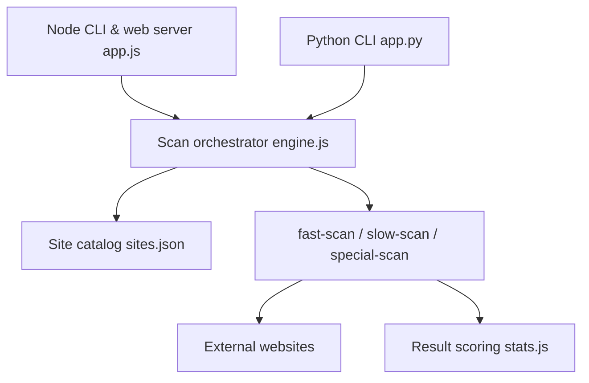

# qeeqbox/social-analyzer

> Local OSINT tool that searches for and scores a username's profiles across more than a thousand sites.

## The problem
Manually checking whether and where a username exists across hundreds of sites, with the risk of false positives.

## What it actually does
Takes one or more usernames and evaluates candidate profiles with a score from 0 to 100 (no, maybe, yes). Three verification modes: fast (HTTP), slow (driven browser) and special (Google, Gmail, Facebook). It adds name analysis, metadata extraction, screenshots, filters by country, type or ranking, JSON export and a graph. The README cites investigating harassment or disinformation as usage contexts, and says it is used by some law enforcement agencies (with a different detection base).

## How it is wired


## Trying it
```bash
git clone https://github.com/qeeqbox/social-analyzer.git
cd social-analyzer
npm install
nodejs app.js --username "johndoe"
# ou en Python
pip3 install social-analyzer
python3 -m social-analyzer --username "johndoe"
```

## Cost and gotchas
Free; the Google and DuckDuckGo APIs are optional. Depending on the modes: Firefox or Chrome, Tesseract, Node. The README says the tool is made for local use, without access control, and should not be exposed as a service. The "private" modules are not in the repository.

## What it is not
Not proof of identity: a "detected" profile remains a probability. Searching for personal data is regulated (GDPR in Europe, purpose and legal basis required); a lawful framework is needed before any use on a person. The AGPL-3.0 license requires sharing the code of a derived service.

## Alternatives
No alternative named in the README.

## For you
Watch: relevant for defensive OSINT monitoring within a clear legal framework, but with no direct link to data / AI work, and the last commit dates from January 2026.
