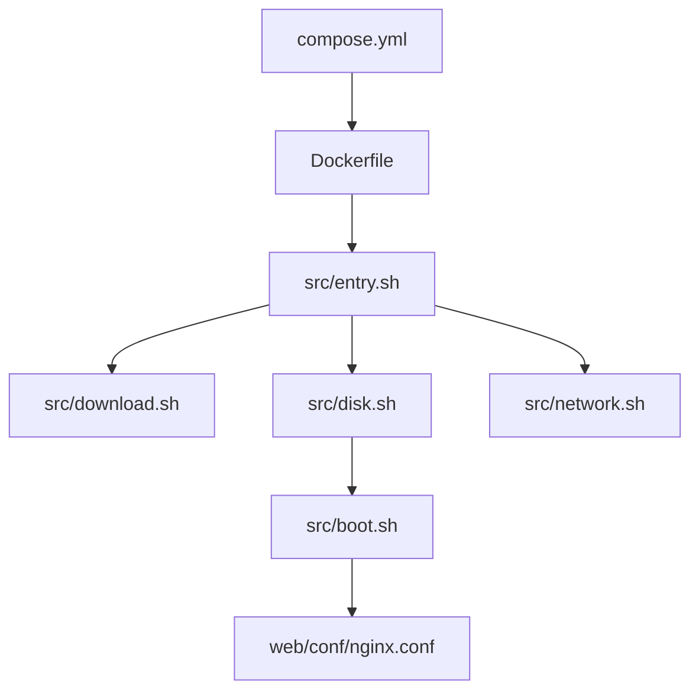

# qemus/qemu

> Docker container that runs a QEMU virtual machine with a web viewer.

## The problem
Starting a disposable Linux VM on a headless server requires configuring QEMU, the disk, the network and remote access.

## What it actually does
The container downloads a distribution chosen by the `BOOT` variable (Ubuntu, Debian, Fedora, Arch, Kali…) or a custom image (`.iso`, `.qcow2`, `.vmdk`, `.vdi`…), creates the disk, configures the network and starts QEMU with KVM. A noVNC viewer serves the screen on port 8006. Multiple disks, USB, GPU and ballooning are configurable.

## How it is wired


## Trying it
```bash
docker run -it --rm --name qemu -e "BOOT=mint" -p 8006:8006 --device=/dev/kvm --device=/dev/net/tun --cap-add NET_ADMIN -v "${PWD:-.}/qemu:/storage" --stop-timeout 120 docker.io/qemux/qemu
```

## Cost and gotchas
Free. Linux host with KVM required (or Windows 11 with nested virtualization); Docker Desktop on Linux, macOS and Windows 10 is not supported. Several GB to download per OS.

## What it is not
Not the right route for Windows or macOS: the README points to dockur/windows and dockur/macos. ARM64 goes through qemu-arm.

## Alternatives
dockur/windows for Windows, dockur/macos for macOS, dockur/proxmox for a management interface.

## For you
Ignore: handy for a test VM, but of no value in itself for a data / AI / MLOps profile.
