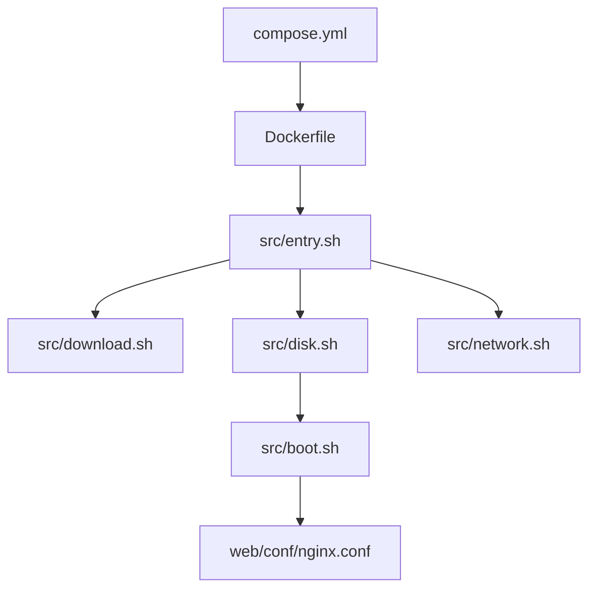

# qemus/qemu

> Conteneur Docker qui lance une machine virtuelle QEMU avec visionneuse web.

## Le problème
Démarrer une VM Linux jetable sur un serveur sans interface graphique demande de configurer QEMU, le disque, le réseau et un accès distant.

## Ce que ça fait vraiment
Le conteneur télécharge une distribution choisie par la variable `BOOT` (Ubuntu, Debian, Fedora, Arch, Kali…) ou une image perso (`.iso`, `.qcow2`, `.vmdk`, `.vdi`…), crée le disque, configure le réseau et démarre QEMU avec KVM. Une visionneuse noVNC sert l'écran sur le port 8006. Disques multiples, USB, GPU et ballooning sont réglables.

## Comment c'est branché


## Essayer
```bash
docker run -it --rm --name qemu -e "BOOT=mint" -p 8006:8006 --device=/dev/kvm --device=/dev/net/tun --cap-add NET_ADMIN -v "${PWD:-.}/qemu:/storage" --stop-timeout 120 docker.io/qemux/qemu
```

## Coût et pièges
Gratuit. Hôte Linux avec KVM requis (ou Windows 11 avec virtualisation imbriquée) ; Docker Desktop sur Linux, macOS et Windows 10 n'est pas supporté. Plusieurs Go à télécharger par OS.

## Ce que ce n'est pas
Ce n'est pas la bonne voie pour Windows ou macOS : le README renvoie vers dockur/windows et dockur/macos. Les ARM64 passent par qemu-arm.

## Alternatives
dockur/windows pour Windows, dockur/macos pour macOS, dockur/proxmox pour une interface de gestion.

## Pour toi
À ignorer : pratique pour une VM de test, mais sans valeur propre pour un profil data / IA / MLOps.

