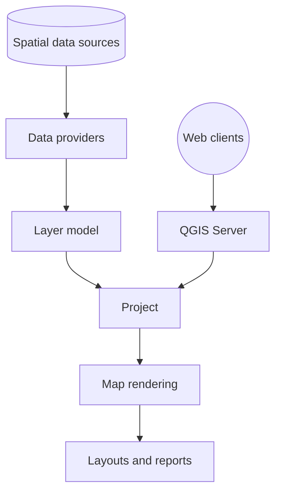

# qgis/QGIS

> Free geographic information system, desktop and server, to analyze, style and publish spatial data.

## The problem
Handling geographic data in varied formats and producing maps requires expensive proprietary software.

## What it actually does
Reads raster, vector, meshes and point clouds through data providers, organizes them into a project of layers, and allows editing, reprojection and more than 200 native processing algorithms (1000+ via GDAL, SAGA, GRASS). Produces maps, layouts and reports. QGIS Server publishes the same project as WMS, WFS and WCS. Extensible through plugins and a Python/C++ API.

## How it is wired

## Trying it
The README gives no command: it points to the download page for precompiled binaries and the build guide. Not documented here.

## Cost and gotchas
Free. Three branches (LTR, LR, nightly) and a monthly bugfix release. Building from source is heavy.

## What it is not
Not a data science tool in itself: it is a graphical GIS. The 5,000+ open issues show a very busy project. GPL license, hence copyleft.

## Alternatives
No alternative named in the README (it only cites processing providers: GDAL, SAGA, GRASS).

## For you
Adopt if you work with geospatial data: it is the free reference, and PyQGIS lets you script it.
