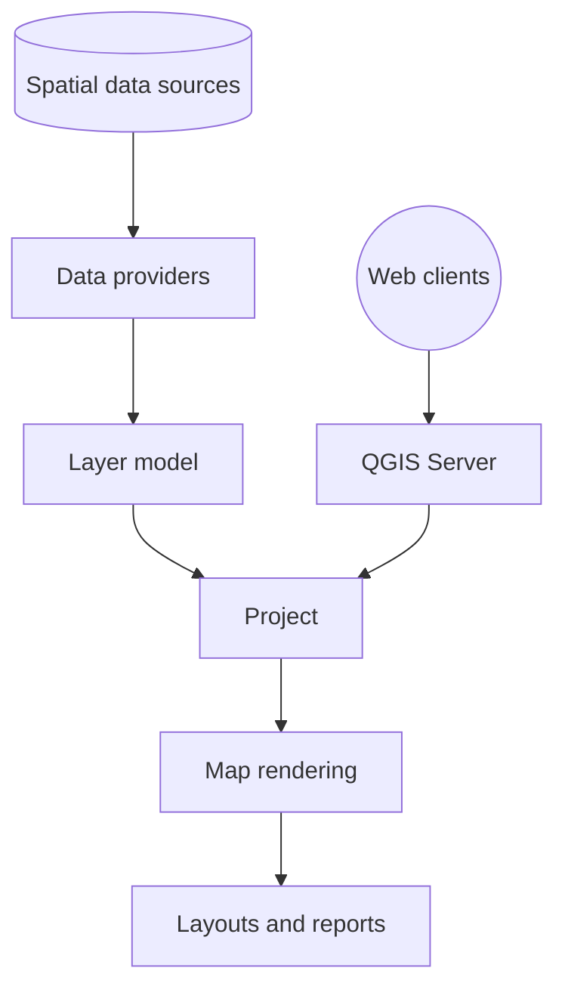

# qgis/QGIS

> Système d'information géographique libre, bureau et serveur, pour analyser, styliser et publier des données spatiales.

## Le problème
Manipuler des données géographiques de formats variés et produire des cartes demande des logiciels propriétaires coûteux.

## Ce que ça fait vraiment
Lit raster, vecteur, maillages et nuages de points via des fournisseurs de données, les organise en projet de couches, permet l'édition, la reprojection et plus de 200 algorithmes de traitement natifs (1000+ via GDAL, SAGA, GRASS). Produit des cartes, des mises en page et des rapports. QGIS Server publie le même projet en WMS, WFS et WCS. Extensible par plugins et API Python/C++.

## Comment c'est branché

## Essayer
Le README ne donne aucune commande : il renvoie vers la page de téléchargement des binaires précompilés et le guide de compilation. Non documenté ici.

## Coût et pièges
Gratuit. Trois branches (LTR, LR, nightly) et une version corrective mensuelle. Compiler depuis les sources est lourd.

## Ce que ce n'est pas
Pas un outil de data science en soi : c'est un SIG graphique. Les plus de 5 000 issues ouvertes montrent un projet très chargé. Licence GPL, donc copyleft.

## Alternatives
Aucune alternative nommée dans le README (il cite seulement des fournisseurs de traitement : GDAL, SAGA, GRASS).

## Pour toi
À adopter si tu traites des données géospatiales : c'est la référence libre, et PyQGIS permet de scripter.

