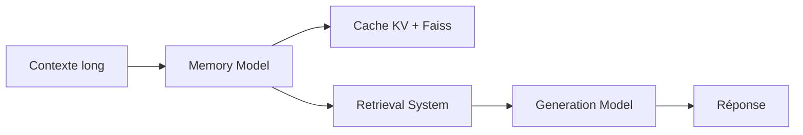

# qhjqhj00/MemoRAG

> A RAG framework where a global-memory model generates clues to better retrieve the useful passages.

## The problem
Classic RAG handles poorly the questions with no explicit information need, which require a global understanding of a long document.

## What it actually does
A memory model encodes a long context (up to 1M tokens according to the README), then produces search clues (`recall`) or rewrites the query. These clues feed a retriever (BGE-M3, Faiss index) and then a generator model, local or via API. The KV cache, the index and the passages are saved: 35 s of encoding versus 1.5 s on reload for 200K tokens. A Lite mode and a paper accepted at TheWebConf 2025.

## How it is wired


## Trying it
```bash
pip install memorag
```
```python
from memorag import MemoRAGLite
pipe = MemoRAGLite()
context = open("examples/harry_potter.txt").read()
pipe.memorize(context, save_dir="harry_potter", print_stats=True)
print(pipe("What's the book's main theme?"))
```

## Cost and gotchas
A 16 to 24 GB GPU is recommended; free Colab (T4) handles half of the example book. Hugging Face models must be downloaded; an API key only if the generator is remote.

## What it is not
Not a ready-to-use product: it is a research base, last push 2025-09-11. Default prompts are in English, performance elsewhere is uncertain.

## Alternatives
- RQ-RAG, HyDE, BGE-M3, Stella-v5: compared in the README's results table.

## For you
Keep an eye on it: a useful idea for RAG over long documents and a Colab notebook to try it, but activity is declining.
