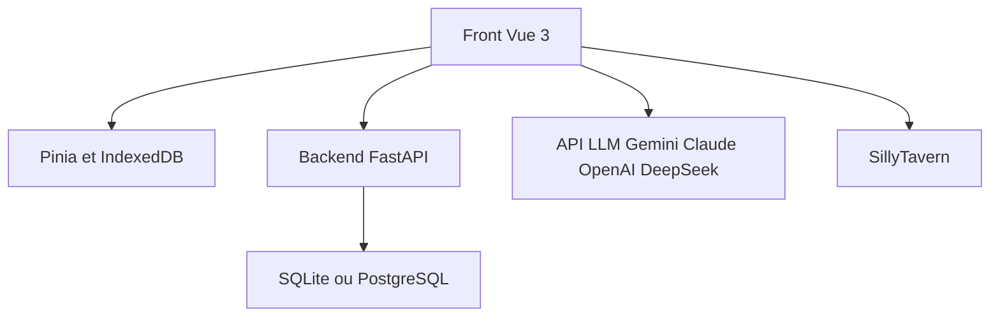

# qianye60/XianTu

> Chinese cultivation text role-playing game where an LLM tells the story, for players.

## The problem
Classic interactive fiction games have fixed scenarios; here the story is generated on the fly by a model.

## What it actually does
Vue 3 web application with an optional FastAPI backend (SQLite by default). It calls Gemini, Claude, OpenAI or DeepSeek to generate the narrative, and handles multiple saves, with import/export and cloud synchronization. It runs standalone or integrated with SillyTavern.

## How it is wired

Simplified diagram based on the sheet, no diagram provided.

## Trying it
```bash
docker run -d -p 8080:80 qianye60/xiantu:latest
npm install
npm run serve
pip install -r server/requirements.txt
uvicorn server.main:app --reload --port 12345
```

## Cost and gotchas
You need an API key from an LLM provider, paid per use. License is free for personal or research use, contact required for commercial use. README in Chinese.

## What it is not
Not open source in the strict sense (commercial use forbidden without agreement). Not a work tool: it is a game.

## Alternatives
- SillyTavern: cited as a compatible environment, not as a competitor.

## For you
Ignore: entertainment unrelated to your work, and the license restricts reuse.
