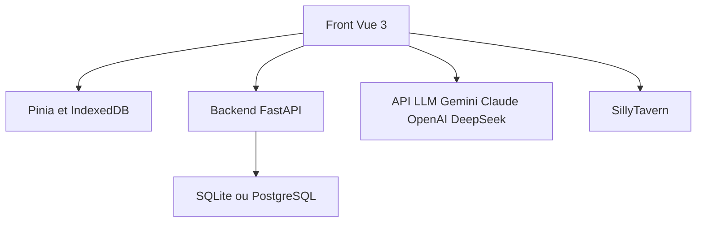

# qianye60/XianTu

> Jeu de rôle textuel chinois de cultivation, où un LLM raconte l'histoire, pour les joueurs.

## Le problème
Les jeux de fiction interactive classiques ont des scénarios figés ; ici l'histoire est générée à la volée par un modèle.

## Ce que ça fait vraiment
Application web Vue 3 avec un backend FastAPI optionnel (SQLite par défaut). Elle appelle Gemini, Claude, OpenAI ou DeepSeek pour générer le récit, et gère les sauvegardes multiples, avec import/export et synchronisation cloud. Elle fonctionne seule ou intégrée à SillyTavern.

## Comment c'est branché

Schéma simplifié d'après la fiche, sans diagramme fourni.

## Essayer
```bash
docker run -d -p 8080:80 qianye60/xiantu:latest
npm install
npm run serve
pip install -r server/requirements.txt
uvicorn server.main:app --reload --port 12345
```

## Coût et pièges
Il faut une clé d'API d'un fournisseur de LLM, payée à l'usage. Licence gratuite pour un usage personnel ou de recherche, contact obligatoire pour le commercial. README en chinois.

## Ce que ce n'est pas
Pas open source au sens strict (usage commercial interdit sans accord). Pas un outil de travail : c'est un jeu.

## Alternatives
- SillyTavern : cité comme environnement compatible, pas comme concurrent.

## Pour toi
À ignorer : divertissement sans lien avec ton métier, et la licence restreint la réutilisation.

