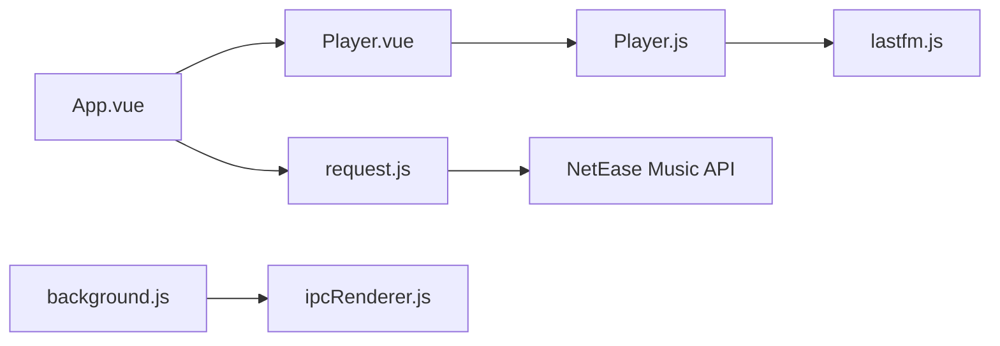

# qier222/YesPlayMusic

> Unofficial Vue/Electron music player for NetEase Cloud Music, aimed at users of that service.

## The problem
NetEase's official client is considered bulky; the author wants a more polished interface, without social features.

## What it actually does
Web client, PWA and Electron (macOS, Windows, Linux): NetEase account login, playback, lyrics, MVs, private FM, daily recommendations, Last.fm scrobbling, global shortcuts, Mpris. It depends on a NeteaseCloudMusicApi API that you must deploy yourself for the web version. The current version is in maintenance: a 2.0 Alpha exists elsewhere.

## How it is wired


## Trying it
```bash
git clone --recursive https://github.com/qier222/YesPlayMusic.git
yarn install
cp .env.example .env
yarn electron:serve
```

## Cost and gotchas
Free, but you need a NetEase account and, for the web version, an API to host. "Personal and study use only" according to the README.

## What it is not
Neither a local file player nor an independent streaming service: everything relies on NetEase. Replacement sources exist but their legality is not addressed.

## Alternatives
- algerkong/AlgerMusicPlayer: similar project cited in the README.
- asxez/MusicBox: likewise.

## For you
Ignore: consumer application tied to a Chinese service, unrelated to data, AI or MLOps.
