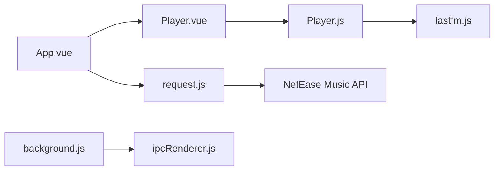

# qier222/YesPlayMusic

> Lecteur de musique Vue/Electron non officiel pour NetEase Cloud Music, destiné aux utilisateurs de ce service.

## Le problème
Le client officiel de NetEase est jugé encombrant ; l'auteur veut une interface plus soignée, sans fonctions sociales.

## Ce que ça fait vraiment
Client web, PWA et Electron (macOS, Windows, Linux) : connexion au compte NetEase, lecture, paroles, MV, FM privée, recommandations quotidiennes, scrobbling Last.fm, raccourcis globaux, Mpris. Il dépend d'une API NeteaseCloudMusicApi à déployer soi-même pour la version web. La version actuelle est en maintenance : une 2.0 Alpha existe ailleurs.

## Comment c'est branché


## Essayer
```bash
git clone --recursive https://github.com/qier222/YesPlayMusic.git
yarn install
cp .env.example .env
yarn electron:serve
```

## Coût et pièges
Gratuit, mais il faut un compte NetEase et, pour la version web, une API à héberger. Usage « personnel et d'étude uniquement » selon le README.

## Ce que ce n'est pas
Ni un lecteur local de fichiers ni un service de streaming indépendant : tout repose sur NetEase. Des sources de remplacement existent mais leur légalité n'est pas traitée.

## Alternatives
- algerkong/AlgerMusicPlayer : projet similaire cité dans le README.
- asxez/MusicBox : idem.

## Pour toi
À ignorer : application grand public liée à un service chinois, sans rapport avec la data, l'IA ou le MLOps.

