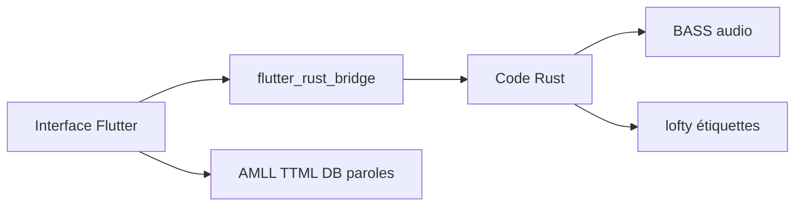

# qingyueyin/Pure-music

> Local music player for Windows built with Flutter and Rust, for files already on disk.

## The problem
Not explicitly documented: the README has no introduction, only screenshots and credits.

## What it actually does
Plays the user's local music files, with no built-in content. Shows list views, library, performance mode, song details and desktop lyrics. Relies on BASS (audio), lofty (tags), AMLL TTML DB (lyrics) and flutter_rust_bridge.

## How it is wired

Simplified diagram based on the sheet, no diagram provided.

## Trying it
```bash
flutter pub get
flutter run

# Construire Release
flutter build windows --release

# Après modification du Rust
cargo install flutter_rust_bridge_codegen
flutter_rust_bridge_codegen generate
```

## Cost and gotchas
Free, built from source (Flutter, Rust). Online lyrics come from third-party platforms, whose rights remain with their rights holders. README in Chinese.

## What it is not
Not a streaming service nor a music library: it provides neither tracks nor copyrighted lyrics.

## Alternatives
None named as an alternative; the README cites coriander_player as the origin of the project.

## For you
Unrelated to data, AI or MLOps, and the README is nearly empty: ignore.
