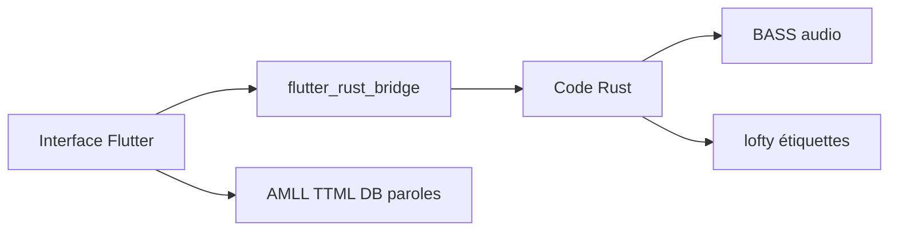

# qingyueyin/Pure-music

> Lecteur de musique local sous Windows en Flutter et Rust, pour fichiers déjà présents sur le disque.

## Le problème
Non documenté explicitement : le README n'a pas de présentation, seulement des captures et des crédits.

## Ce que ça fait vraiment
Joue les fichiers musicaux locaux de l'utilisateur, sans contenu intégré. Affiche vues liste, bibliothèque, mode performance, détails de chanson et paroles de bureau. S'appuie sur BASS (audio), lofty (étiquettes), AMLL TTML DB (paroles) et flutter_rust_bridge.

## Comment c'est branché

Schéma simplifié d'après la fiche, sans diagramme fourni.

## Essayer
```bash
flutter pub get
flutter run

# Construire Release
flutter build windows --release

# Après modification du Rust
cargo install flutter_rust_bridge_codegen
flutter_rust_bridge_codegen generate
```

## Coût et pièges
Gratuit, compilation depuis les sources (Flutter, Rust). Les paroles en ligne viennent de plateformes tierces, dont les droits restent à leurs ayants droit. README en chinois.

## Ce que ce n'est pas
Pas un service de streaming ni une bibliothèque de musique : il ne fournit ni morceaux ni paroles protégées.

## Alternatives
Aucune nommée comme alternative ; le README cite coriander_player comme origine du projet.

## Pour toi
Sans lien avec data, IA ou MLOps, et README quasi vide : à ignorer.

