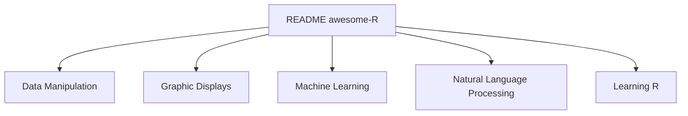

# qinwf/awesome-R

> Curated list of R packages and tools, by theme, for anyone looking for an R library.

## The problem
The CRAN ecosystem is very vast; finding the right package by domain takes time.

## What it actually does
Thematic list: IDE, syntax, data manipulation, formats, graphics, HTML widgets, reproducible research, web, parallel computing, databases, machine learning, language processing, Bayesian, optimization, finance, bioinformatics and network analysis. Each line gives a package name and a short description. The supplied README is truncated mid-list.

## How it is wired
Simplified diagram based on the sheet, no diagram provided.

## Trying it
No documented command: just browse the list.

## Cost and gotchas
Free. No license declared and last push on 2025-09-18, so more than a year ago: some cited packages are obsolete (mlr is marked deprecated).

## What it is not
Not a guide to learning R nor a quality ranking. It does not replace the CRAN Task Views.

## Alternatives
Awesome-machine-learning, from which the list takes inspiration.

## For you
To watch: useful only if your team keeps some R, for example for tidymodels, torch or targets; otherwise the Python ecosystem already covers these needs.
