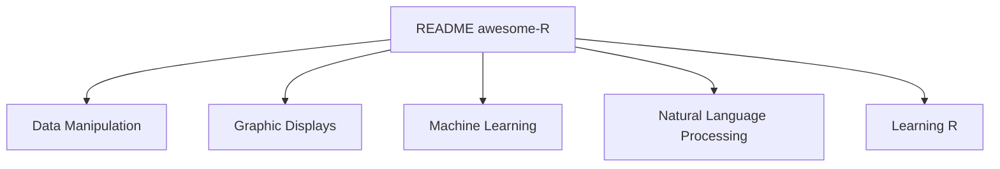

# qinwf/awesome-R

> Liste organisée de paquets et d'outils R, par thème, pour qui cherche une bibliothèque R.

## Le problème
L'écosystème CRAN est très vaste ; trouver le bon paquet par domaine prend du temps.

## Ce que ça fait vraiment
Liste thématique : IDE, syntaxe, manipulation de données, formats, graphiques, widgets HTML, recherche reproductible, web, calcul parallèle, bases de données, apprentissage automatique, traitement du langage, bayésien, optimisation, finance, bio-informatique et analyse de réseaux. Chaque ligne donne un nom de paquet et une description courte. Le README fourni est tronqué en cours de liste.

## Comment c'est branché
Schéma simplifié d'après la fiche, sans diagramme fourni.

## Essayer
Aucune commande documentée : il suffit de parcourir la liste.

## Coût et pièges
Gratuit. Aucune licence déclarée et dernier push le 2025-09-18, donc plus d'un an : certains paquets cités sont obsolètes (mlr est marqué déprécié).

## Ce que ce n'est pas
Ce n'est pas un guide d'apprentissage de R ni un classement de qualité. Il ne remplace pas les CRAN Task Views.

## Alternatives
Awesome-machine-learning, dont la liste s'inspire.

## Pour toi
À surveiller : utile seulement si ton équipe garde du R, par exemple pour tidymodels, torch ou targets ; sinon l'écosystème Python couvre déjà ces besoins.

