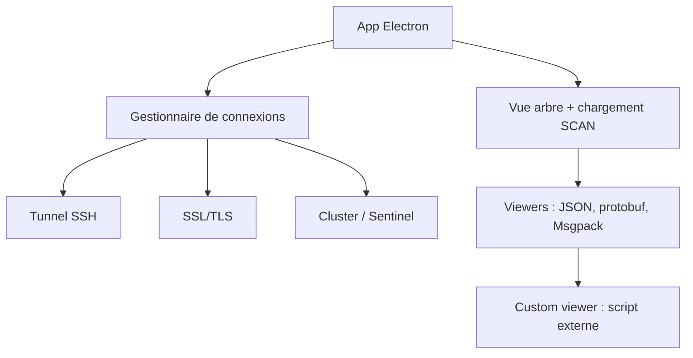

# qishibo/AnotherRedisDesktopManager

> Cross-platform graphical Redis client, designed to hold up on databases with very many keys.

## The problem
Graphical Redis clients collapse when loading databases with millions of keys.
Inspecting a binary, protobuf or compressed value forces you to leave the tool.

## What it actually does
Electron client for Linux, Windows and macOS, distributed as exe, AppImage, dmg, snap, brew, chocolatey, winget.
Loading of large key sets via SCAN, tree view, multiple selection and deletion, memory analysis by folder, read-only mode, execution log.
Formats: editable JSON, Msgpack, protobuf, Java, Pickle, Brotli/Gzip/Deflate, RedisJSON, TimeSeries, Vector, ARRAY; custom viewers calling your script with `{KEY}`, `{VALUE}`, `{HEX}` or `{HEX_FILE}`.
Connections: Cluster, Sentinel, SSL/TLS, SSH tunnel (password or private key), Redis 6 ACL, connection groups, startup via CLI arguments.

## How it is wired


## Trying it
```bash
choco install another-redis-desktop-manager
winget install qishibo.AnotherRedisDesktopManager
sudo snap install another-redis-desktop-manager
brew install --cask another-redis-desktop-manager
```

## Cost and gotchas
Free through GitHub Releases and package managers; the Windows Store and App Store versions are paid and serve as sponsorship.
With snap, you need `sudo snap connect another-redis-desktop-manager:ssh-keys` to access `~/.ssh`; on macOS, remove quarantine with `xattr -rd`.

## What it is not
It is not a server tool or a production monitoring tool: it is a desktop client.
It is not an organization project: the feature log shows year-long periods with nothing new.
Custom viewers run local scripts with the key's value as an argument: handle with care.

## Alternatives
No alternative is named in the README.

## For you
A comfort utility; keep it handy if you work with Redis, without making it a team dependency.
