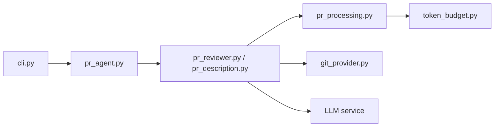

# qodo-ai/pr-agent

> Open-source agent that describes, reviews and improves pull requests with an LLM.

## The problem
PR reviews are slow and uneven; the description is often sloppy.

## What it actually does
Commands `/describe`, `/review`, `/improve`, `/ask`, `/similar_issue`. Each tool makes a single LLM call. Compression of large diffs. Git providers: GitHub, GitLab, Bitbucket, Azure DevOps, Gitea; models through LiteLLM. Community "legacy" project from Qodo, distinct from the commercial offering.

## How it is wired


## Trying it
```bash
pip install pr-agent
export OPENAI_KEY=your_key_here
pr-agent --pr_url https://github.com/owner/repo/pull/123 review
```

## Cost and gotchas
LLM key at your expense. `/help_docs` disabled since v0.36.1 (credential leak, #2445). Docker images under `pragent/pr-agent` since 0.34.2.

## What it is not
Not the Qodo offering for open source. The README claims a single call per tool; quality depends on the model.

## Alternatives
No alternative named in the README.

## For you
To adopt to try assisted review as a GitHub Action: MIT, active (push late September 2026), cost limited to your LLM calls.
