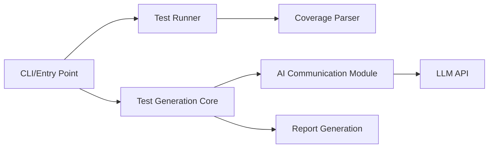

# qodo-ai/qodo-cover

> CLI that uses an LLM to generate unit tests until a target coverage is reached.

## The problem
Writing tests for existing code is time-consuming; coverage stalls for lack of time.

## What it actually does
Loop: run the test command, read the coverage report (Cobertura, JaCoCo), build a prompt, ask the LLM for tests.
Keeps only the tests that pass and increase coverage, until `--desired-coverage` or `--max-iterations`.
Any model via LiteLLM; full-repository mode; recording/replay of LLM responses.
Python, Go, Java examples; `test_results.html` report.

## How it is wired


## Trying it
```bash
pip install git+https://github.com/qodo-ai/qodo-cover.git
poetry install
cover-agent --source-file-path "templated_tests/python_fastapi/app.py" --test-file-path "templated_tests/python_fastapi/test_app.py" --project-root "templated_tests/python_fastapi" --code-coverage-report-path "templated_tests/python_fastapi/coverage.xml" --test-command "pytest --cov=. --cov-report=xml --cov-report=term" --test-command-dir "templated_tests/python_fastapi" --coverage-type "cobertura" --desired-coverage 70 --max-iterations 10
```

## Cost and gotchas
OpenAI (or other) key at your expense, billed per iteration; optional W&B receives prompts and responses.

## What it is not
No longer maintained since June 2025 according to the README. Coverage is not quality: the generated tests verify current behavior, bugs included. AGPL-3.0.

## Alternatives
No alternative named in the README (Qodo's Pro version is commercial).

## For you
Ignore: abandoned by its publisher and under AGPL, while a current code assistant generates tests just as well in your editor.
