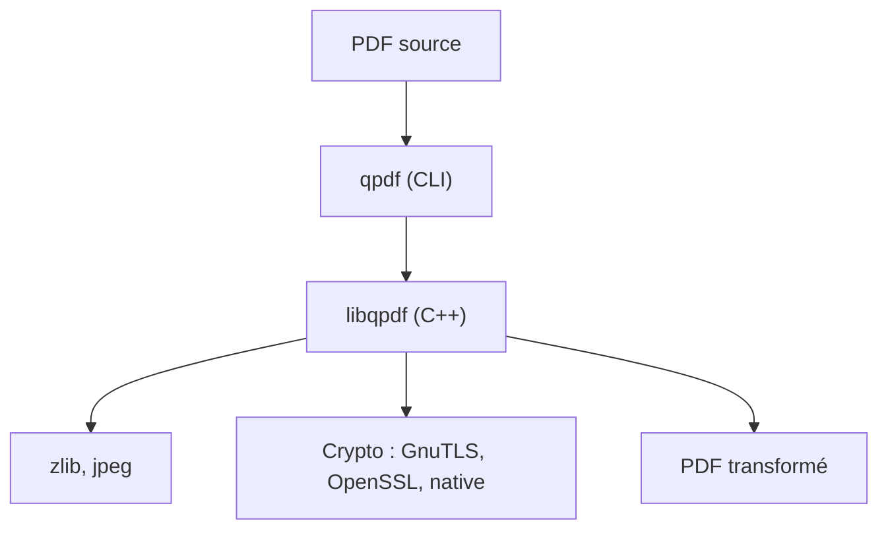

# qpdf/qpdf

> Command-line tool and C++ library to transform the structure of PDF files, for developers.

## The problem
Merging, splitting, encrypting or repairing PDFs without touching the content requires manipulating their internal structure.

## What it actually does
qpdf applies content-preserving transformations: linearization, encryption, splitting, merging, inspection. It can create a PDF if you supply all the content. It does not render pages and does not extract text. Zopfli, optional, compresses better but about 100 times slower.

## How it is wired
Simplified diagram based on the fiche, no diagram provided.


## Trying it
```bash
cmake -S . -B build -DCMAKE_BUILD_TYPE=RelWithDebInfo
cmake --build build
cmake --install build
```

## Cost and gotchas
Free. A C++20 compiler is needed to build. Unsigned macOS binaries: remove the quarantine with `xattr -r -d com.apple.quarantine bin lib`. RC4 remains readable for old PDFs.

## What it is not
Neither a rendering engine, nor a text extractor, nor a high-level interface to page content. It is a structure tool.

## Alternatives
No alternative named in the README.

## For you
Adopt it as a PDF preprocessing building block (splitting, repair, decryption) before text extraction, since it is stable and needs no service.
