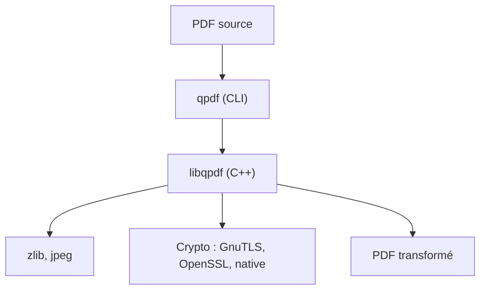

# qpdf/qpdf

> Outil en ligne de commande et bibliothèque C++ pour transformer la structure de fichiers PDF, pour développeurs.

## Le problème
Fusionner, découper, chiffrer ou réparer des PDF sans toucher au contenu exige de manipuler leur structure interne.

## Ce que ça fait vraiment
qpdf applique des transformations qui préservent le contenu : linéarisation, chiffrement, découpe, fusion, inspection. Il peut créer un PDF si tu fournis tout le contenu. Il ne rend pas les pages et n'extrait pas le texte. Zopfli, en option, compresse mieux mais environ 100 fois plus lentement.

## Comment c'est branché
Schéma simplifié d'après la fiche, sans diagramme fourni.


## Essayer
```bash
cmake -S . -B build -DCMAKE_BUILD_TYPE=RelWithDebInfo
cmake --build build
cmake --install build
```

## Coût et pièges
Gratuit. Compilateur C++20 pour construire. Binaires macOS non signés : retirer la quarantaine avec `xattr -r -d com.apple.quarantine bin lib`. RC4 reste lisible pour les anciens PDF.

## Ce que ce n'est pas
Ni moteur de rendu, ni extracteur de texte, ni interface haut niveau sur le contenu des pages. C'est un outil de structure.

## Alternatives
Aucune alternative nommée dans le README.

## Pour toi
À adopter comme brique de prétraitement PDF (découpe, réparation, déchiffrement) avant extraction de texte, car il est stable et sans service.

