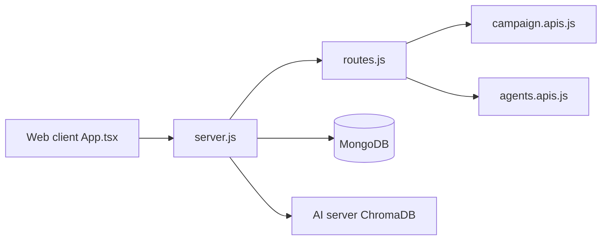

# qrev-ai/qrev

> AI agent-based sales platform positioning itself as an open source alternative to Salesforce.

## The problem
Traditional CRMs are expensive and hard to customize, and are not designed around agents.

## What it actually does
Three components: React client, Node application server (MongoDB) and a separate AI server (Langchain, ChromaDB, SQLAlchemy). The code shows agents, campaigns, CRM and integrations (Zoom, Google). A "super-agent" Qai is meant to coordinate internal agents; CSV upload of contacts to generate campaigns. The README speaks of an early version.

## How it is wired


## Trying it
```bash
git clone https://github.com/qrev-ai/qrev.git
cd server && npm ci && npm start
cd ../client && npm install && npm start
```

## Cost and gotchas
Three services to run, MongoDB, JWT secrets, Google credentials and LLM keys. Last push February 2026.

## What it is not
Not a ready-to-use CRM: active development, AI server instructions deferred to another README. AGPL-3.0 license: obligations if you host it.

## Alternatives
- Salesforce: cited as the reference to replace.

## For you
Ignore: a sales product outside your scope, AGPL and low maturity.
