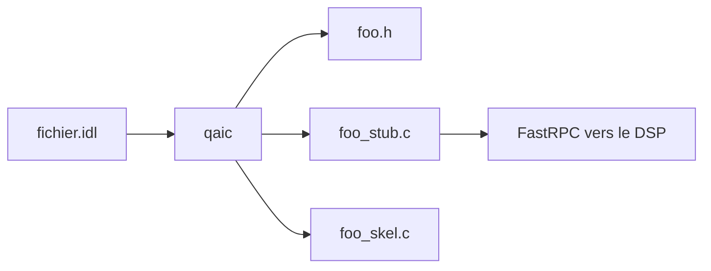

# qualcomm/QAIC

> Command-line IDL compiler that generates stubs and skels to call the Hexagon DSP from the CPU.

## The problem
Calling a function running on the Qualcomm DSP from the application without hand-writing the serialization code.

## What it actually does
`qaic` compiles IDL files (derived from OMG IDL, with the `in` and `rout` modes) into a C header, a stub (APPS side) and a skel (DSP side). Communication goes through FastRPC. Options: `-o`, `-I`, `-st` (standard C types), `-ho`, `-ro`, `-s`, external preprocessor via `-p`.

## How it is wired
Simplified diagram based on the sheet, no diagram provided.


## Trying it
```bash
qaic --header-only foo.idl bar.idl
qaic foo.idl
qaic -I../bar -I../far -o out foo.idl
qaic -st foo.idl
```

## Cost and gotchas
The README does not say how to build `qaic`. It targets the Hexagon SDK and Qualcomm hardware. Unions are not supported, `out` and `inout` are not supported, 255 buffers maximum.

## What it is not
Not an inference or machine learning tool: an interface compiler for embedded work.

## Alternatives
None named in the README.

## For you
Ignore: only useful for programming the Hexagon DSP, far from everyday data/AI/MLOps work.
