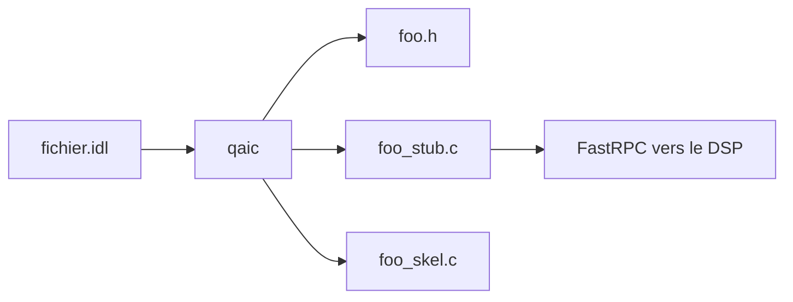

# qualcomm/QAIC

> Compilateur IDL en ligne de commande qui génère stubs et skels pour appeler le DSP Hexagon depuis le CPU.

## Le problème
Appeler une fonction exécutée sur le DSP Qualcomm depuis l'application sans écrire à la main le code de sérialisation.

## Ce que ça fait vraiment
`qaic` compile des fichiers IDL (dérivés d'OMG IDL, avec les modes `in` et `rout`) en en-tête C, stub (côté APPS) et skel (côté DSP). La communication passe par FastRPC. Options : `-o`, `-I`, `-st` (types C standard), `-ho`, `-ro`, `-s`, préprocesseur externe via `-p`.

## Comment c'est branché
Schéma simplifié d'après la fiche, sans diagramme fourni.


## Essayer
```bash
qaic --header-only foo.idl bar.idl
qaic foo.idl
qaic -I../bar -I../far -o out foo.idl
qaic -st foo.idl
```

## Coût et pièges
Le README ne dit pas comment compiler `qaic`. Il vise le Hexagon SDK et du matériel Qualcomm. Unions non supportées, `out` et `inout` non supportés, 255 tampons maximum.

## Ce que ce n'est pas
Pas un outil d'inférence ni de machine learning : un compilateur d'interfaces pour l'embarqué.

## Alternatives
Aucune nommée dans le README.

## Pour toi
À ignorer : utile seulement pour programmer le DSP Hexagon, loin d'un travail data/IA/MLOps courant.

