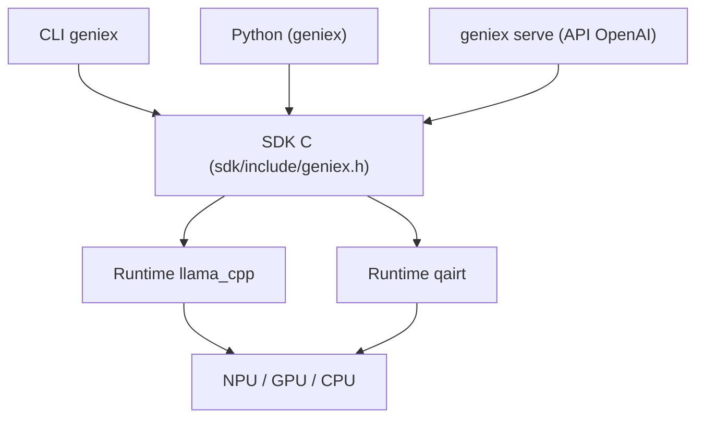

# qualcomm/nexa-sdk

> LLM and VLM inference runtime on Qualcomm devices (Hexagon NPU, Adreno GPU, CPU), with CLI, Python and OpenAI server.

## The problem
Running generative models on a Snapdragon NPU requires proprietary toolchains and precompiled bundles.

## What it actually does
A single C SDK exposed as a CLI (`geniex`), Python, Kotlin/Java, Docker and an OpenAI-compatible server. Two runtimes: llama.cpp (GGUF from Hugging Face, ModelScope, Docker Hub) and Qualcomm AI Engine Direct (precompiled AI Hub bundles, NPU only). The README recommends Q4_0 precision for the Hexagon NPU.

## How it is wired


## Trying it
```bash
curl -fsSL https://qaihub-public-assets.s3.us-west-2.amazonaws.com/qai-hub-geniex/install.sh | sh
geniex infer google/gemma-4-E4B-it-qat-q4_0-gguf
pip install geniex
geniex pull ai-hub-models/Qwen3-4B-Instruct-2507
geniex serve
```

## Cost and gotchas
Installers for Windows ARM64 and Linux ARM64: the README does not mention x86. NPU bundles are tied to the chipset.

## What it is not
Not a general-purpose tool for x86 PCs or NVIDIA GPUs. `qairt` bundles only run on the NPU.

## Alternatives
- llama.cpp: used internally by GenieX, more portable outside Qualcomm.

## For you
Worth watching: relevant if you target embedded Snapdragon inference, otherwise unusable without this hardware.
