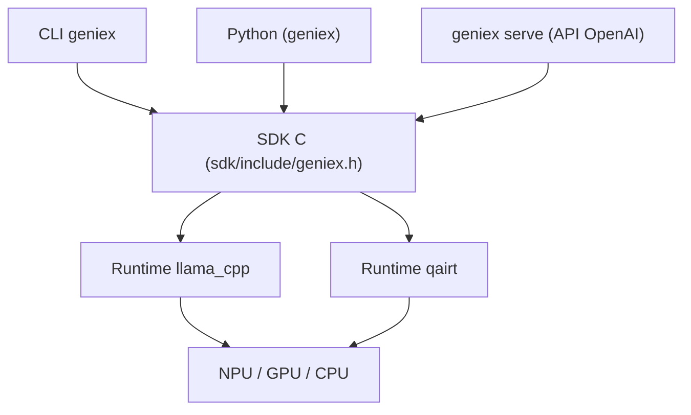

# qualcomm/nexa-sdk

> Runtime d'inférence LLM et VLM sur appareils Qualcomm (NPU Hexagon, GPU Adreno, CPU), avec CLI, Python et serveur OpenAI.

## Le problème
Faire tourner des modèles génératifs sur NPU Snapdragon demande des chaînes d'outils propriétaires et des bundles précompilés.

## Ce que ça fait vraiment
Un SDK C unique exposé en CLI (`geniex`), Python, Kotlin/Java, Docker et serveur compatible OpenAI. Deux runtimes : llama.cpp (GGUF depuis Hugging Face, ModelScope, Docker Hub) et Qualcomm AI Engine Direct (bundles précompilés AI Hub, NPU seul). Le README recommande la précision Q4_0 pour le NPU Hexagon.

## Comment c'est branché


## Essayer
```bash
curl -fsSL https://qaihub-public-assets.s3.us-west-2.amazonaws.com/qai-hub-geniex/install.sh | sh
geniex infer google/gemma-4-E4B-it-qat-q4_0-gguf
pip install geniex
geniex pull ai-hub-models/Qwen3-4B-Instruct-2507
geniex serve
```

## Coût et pièges
Installateurs pour Windows ARM64 et Linux ARM64 : le README ne mentionne pas de x86. Bundles NPU liés au chipset.

## Ce que ce n'est pas
Pas un outil généraliste pour PC x86 ou GPU NVIDIA. Les bundles `qairt` ne tournent que sur NPU.

## Alternatives
- llama.cpp : utilisé en interne par GenieX, plus portable hors Qualcomm.

## Pour toi
Surveiller : pertinent si tu vises l'inférence embarquée Snapdragon, sinon inutilisable sans ce matériel.

