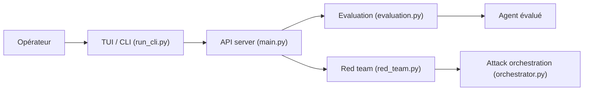

# qualifire-dev/rogue

> Platform that tests AI agents against business rules and simulates attacks, for teams deploying agents.

## The problem
An AI agent can break a policy or be manipulated (injection, data leaks) without anyone noticing before production.

## What it actually does
- Automatic evaluation: generates scenarios from your business context, converses with the agent, and an LLM judge produces reasoned pass/fail reports.
- Red teaming: more than 75 vulnerabilities, 20 attack techniques, a CVSS-style risk score, mapping to OWASP, MITRE ATLAS, NIST, EU AI Act, GDPR.
- Client-server architecture: server, TUI (Go + Bubble Tea) and CLI for CI.
- Protocols: A2A, MCP or a Python `call_agent` function.

## How it is wired


## Trying it
```bash
uvx rogue-ai
uvx rogue-ai cli --evaluated-agent-url http://localhost:10001 --judge-llm openai/gpt-4o-mini --business-context-file ./.rogue/business_context.md
uvx rogue-ai --example=tshirt_store
uvx rogue-ai cli --random-seed 42
```

## Cost and gotchas
The judge LLM and the attacks consume billed calls (OpenAI, Anthropic or Google); a full scan takes about 30 to 45 minutes. GitHub does not identify the license: check before commercial use.

## What it is not
Not a compliance certification: the reports are produced by an LLM judge. Not a fixer: it finds problems, it does not repair them.

## Alternatives
No alternative named in the README.

## For you
Worth watching: it covers agent evaluation and red teaming precisely, but the unclear license blocks firm adoption.
