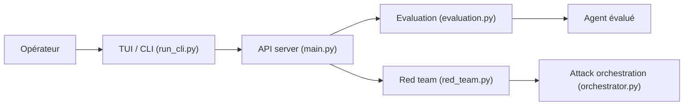

# qualifire-dev/rogue

> Plateforme qui teste des agents IA contre des règles métier et simule des attaques, pour équipes qui déploient des agents.

## Le problème
Un agent IA peut enfreindre une politique ou se faire manipuler (injection, fuite de données) sans qu'on le voie avant la production.

## Ce que ça fait vraiment
- Évaluation automatique : génère des scénarios depuis ton contexte métier, dialogue avec l'agent et un LLM juge rend des rapports pass/fail motivés.
- Red teaming : plus de 75 vulnérabilités, 20 techniques d'attaque, score de risque de type CVSS, rapprochement avec OWASP, MITRE ATLAS, NIST, EU AI Act, GDPR.
- Architecture client-serveur : serveur, TUI (Go + Bubble Tea) et CLI pour la CI.
- Protocoles : A2A, MCP ou une fonction Python `call_agent`.

## Comment c'est branché


## Essayer
```bash
uvx rogue-ai
uvx rogue-ai cli --evaluated-agent-url http://localhost:10001 --judge-llm openai/gpt-4o-mini --business-context-file ./.rogue/business_context.md
uvx rogue-ai --example=tshirt_store
uvx rogue-ai cli --random-seed 42
```

## Coût et pièges
Le LLM juge et les attaques consomment des appels facturés (OpenAI, Anthropic ou Google) ; un scan complet dure environ 30 à 45 minutes. GitHub n'identifie pas la licence : à vérifier avant usage commercial.

## Ce que ce n'est pas
Pas une certification de conformité : les rapports sont produits par un LLM juge. Pas un correctif : il trouve, il ne répare pas.

## Alternatives
Aucune alternative nommée dans le README.

## Pour toi
À surveiller : couvre précisément l'évaluation et le red teaming d'agents, mais la licence floue bloque une adoption ferme.

