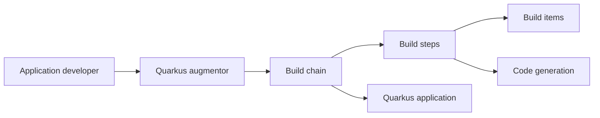

# quarkusio/quarkus

> Container- and cloud-oriented Java framework, fast startup, JVM or native execution.

## The problem
Classic Java applications start slowly and consume a lot of memory in containers.

## What it actually does
Moves much of the work to build time: a chain of build steps and build items (augmentation) generates the code and the native-image configuration. Relies on standards (JAX-RS/RESTEasy, Hibernate ORM, Vert.x, MicroProfile, Camel); a model unifying imperative and reactive styles; Dev UI for development.

## How it is wired

## Trying it
No command in the README; it points to the documentation and the contribution guide for building.

## Cost and gotchas
Free; JDK required. The "Python" prerequisite does not apply: this is Java. The README does not detail the native build prerequisites.

## What it is not
Not a data science framework. The README presents no AI extension, although the framework has some.

## Alternatives
No alternative named in the README.

## For you
Ignore: Java framework for microservices; of no interest if your stack is Python.
