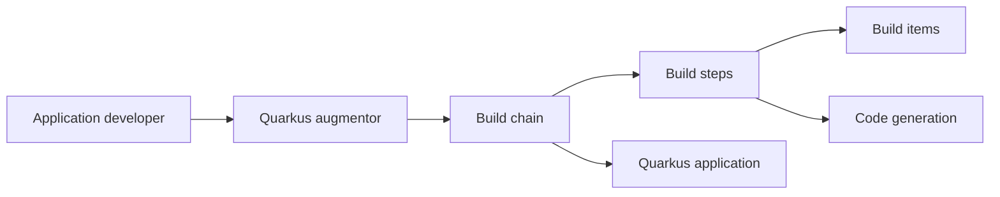

# quarkusio/quarkus

> Framework Java orienté conteneurs et cloud, démarrage rapide, exécution JVM ou native.

## Le problème
Les applications Java classiques démarrent lentement et consomment beaucoup de mémoire dans les conteneurs.

## Ce que ça fait vraiment
Déplace une grande partie du travail à la compilation : une chaîne d'étapes et d'éléments de build (augmentation) génère le code et la configuration native-image. S'appuie sur des standards (JAX-RS/RESTEasy, Hibernate ORM, Vert.x, MicroProfile, Camel) ; modèle unifiant impératif et réactif ; Dev UI pour le développement.

## Comment c'est branché

## Essayer
Aucune commande dans le README ; renvoi à la documentation et au guide de contribution pour la compilation.

## Coût et pièges
Gratuit ; JDK requis. Le prérequis « Python » ne s'applique pas : c'est du Java. Le README ne détaille pas les prérequis de compilation native.

## Ce que ce n'est pas
Pas un framework de data science. Le README ne présente pas d'extension IA, bien que le framework en possède.

## Alternatives
Aucune alternative nommée dans le README.

## Pour toi
À ignorer : framework Java pour microservices ; sans intérêt si ta stack est Python.

