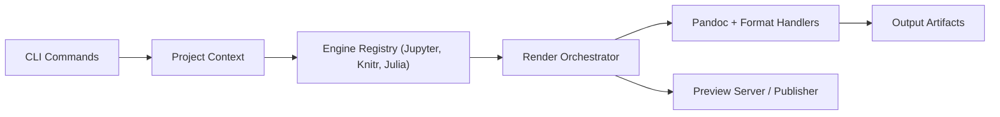

# quarto-dev/quarto-cli

> Scientific publishing system based on Pandoc, which runs Python/R/Julia code inside Markdown documents.

## The problem
Reports, articles and sites mixing code, results and text are hard to maintain by hand.

## What it actually does
You write in Markdown with code executed by Jupyter, Knitr or Observable; Quarto converts via Pandoc to HTML, PDF, books or sites. Adds cross-references, subfigures, callouts, multi-document projects, extensions, a visual editor and integration with JupyterLab, RStudio and VS Code. Publishing and a preview server are included.

## How it is wired


## Trying it
```bash
git clone https://github.com/quarto-dev/quarto-cli
cd quarto-cli
./configure.sh
cd tests
./run-tests.sh
```

## Cost and gotchas
Free. The README shows the development version; the stable installation goes through the website. Many issues (1,880). The license is present but not identified by GitHub: to be checked.

## What it is not
Not an execution environment: it relies on Jupyter, R or Julia installed separately.

## Alternatives
None named in the README (Jupyter, Knitr and Pandoc are building blocks).

## For you
Adopt: turning reports and notebooks into publishable documents is central to a data profile; check the license before any corporate use.
