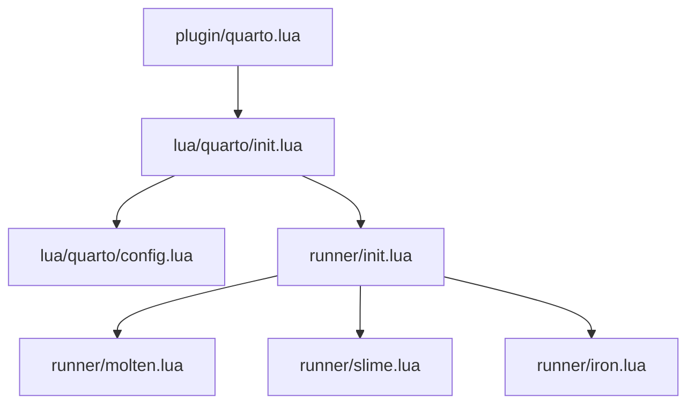

# quarto-dev/quarto-nvim

> Neovim plugin for writing Quarto documents, with LSP in cells and code execution.

## The problem
Quarto documents mix R, Python, Julia and text: the editor loses completion and diagnostics inside cells.

## What it actually does
Enables LSP in cells through otter.nvim (hover, definition, completion) and sends cells to molten-nvim, vim-slime or iron.nvim. Launches the `quarto preview` preview in a Neovim terminal.

## How it is wired


## Trying it
```bash
# Dans Neovim
:QuartoPreview
:QuartoSend
:QuartoSendAll
```

## Cost and gotchas
Neovim 0.10 or later, otter.nvim and treesitter. The Quarto CLI must be installed for the preview. For R, a `.lintr` file reduces spurious diagnostics. License not identified.

## What it is not
It runs nothing itself: it delegates to the chosen code runner.

## Alternatives
- molten-nvim, vim-slime, iron.nvim (code runners, partners rather than rivals).

## For you
Adopt if you work in Quarto notebooks under Neovim with Python or R; otherwise irrelevant.
