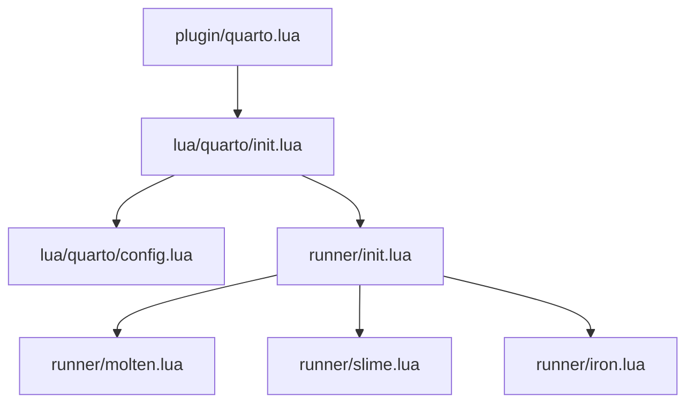

# quarto-dev/quarto-nvim

> Plugin Neovim pour écrire des documents Quarto, avec LSP dans les cellules et exécution de code.

## Le problème
Les documents Quarto mêlent R, Python, Julia et texte : l'éditeur perd complétion et diagnostics dans les cellules.

## Ce que ça fait vraiment
Active le LSP dans les cellules via otter.nvim (survol, définition, complétion) et envoie les cellules à molten-nvim, vim-slime ou iron.nvim. Lance l'aperçu `quarto preview` dans un terminal Neovim.

## Comment c'est branché


## Essayer
```bash
# Dans Neovim
:QuartoPreview
:QuartoSend
:QuartoSendAll
```

## Coût et pièges
Neovim 0.10 ou plus, otter.nvim et treesitter. Le Quarto CLI doit être installé pour l'aperçu. Pour R, un fichier `.lintr` réduit les diagnostics parasites. Licence non identifiée.

## Ce que ce n'est pas
Il n'exécute rien lui-même : il délègue au lanceur de code choisi.

## Alternatives
- molten-nvim, vim-slime, iron.nvim (lanceurs de code, partenaires plutôt que rivaux).

## Pour toi
À adopter si tu travailles en notebooks Quarto sous Neovim avec Python ou R ; sinon sans objet.

