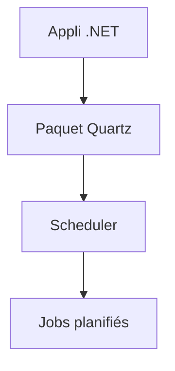

# quartznet/quartznet

> Enterprise job scheduler for .NET, installed as a NuGet package.

## The problem
Running scheduled tasks reliably in a .NET application takes more than a simple timer.

## What it actually does
The `Quartz` package includes dependency injection, hosting, a health check and System.Text.Json serialization. Quartz.NET 4 targets .NET 10 only; the 3.x branch supports .NET Standard 2.0 and .NET Framework 4.6.2. The README points to the website for documentation; it does not describe triggers or storage.

## How it is wired
Simplified diagram based on the fiche, no diagram provided.



## Trying it
```bash
dotnet add package Quartz
./build.sh
```

## Cost and gotchas
Free. Real requirement: .NET 10 SDK; integration tests require Docker. Version 4 is not compatible with older .NET.

## What it is not
Not a data pipeline orchestrator like Airflow: it is a scheduling library embedded in a .NET app.

## Alternatives
No alternative named in the README.

## For you
Ignore: reserved for the .NET ecosystem; to schedule data pipelines you have better-suited orchestrators.
