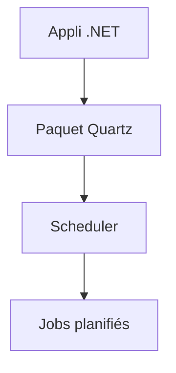

# quartznet/quartznet

> Planificateur de tâches d'entreprise pour .NET, installé comme paquet NuGet.

## Le problème
Lancer des tâches planifiées de façon fiable dans une application .NET demande plus qu'un simple minuteur.

## Ce que ça fait vraiment
Le paquet `Quartz` inclut l'injection de dépendances, l'hébergement, un health check et la sérialisation System.Text.Json. Quartz.NET 4 cible .NET 10 uniquement ; la branche 3.x gère .NET Standard 2.0 et .NET Framework 4.6.2. Le README renvoie au site pour la documentation ; il ne décrit pas les triggers ni le stockage.

## Comment c'est branché
Schéma simplifié d'après la fiche, sans diagramme fourni.



## Essayer
```bash
dotnet add package Quartz
./build.sh
```

## Coût et pièges
Gratuit. Besoin réel : SDK .NET 10 ; les tests d'intégration exigent Docker. La version 4 n'est pas compatible avec les anciens .NET.

## Ce que ce n'est pas
Pas un orchestrateur de pipelines de données comme Airflow : c'est une bibliothèque de planification intégrée à une appli .NET.

## Alternatives
Aucune alternative nommée dans le README.

## Pour toi
À ignorer : réservé à l'écosystème .NET ; pour planifier des pipelines data tu as des orchestrateurs plus adaptés.

