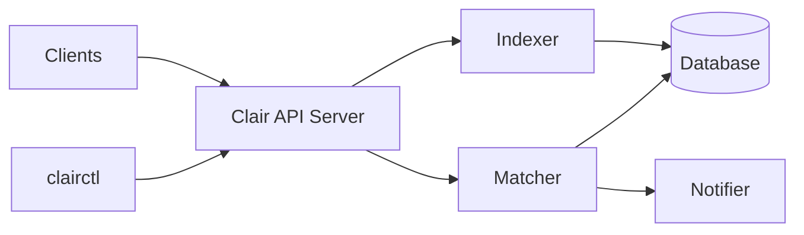

# quay/clair

> Static vulnerability analysis service for OCI/Docker container images, via API.

## The problem
Container images embed vulnerable packages that are invisible without a tool to index them and match them against CVE databases.

## What it actually does
The README is very short: clients index their images through the Clair API then match them against known vulnerabilities.
From the described architecture: `indexer`, `matcher`, `notifier` modules, a `clairctl` CLI, an `openapi.yaml` spec, written in Go.
All the documentation is deferred to the external "The book".

## How it is wired

## Trying it
No command documented in the README (use the releases, not `main`).

## Cost and gotchas
Free. The `main` branch may be broken: take a release. Database and deployment are not documented here.

## What it is not
Not a CLI scanner to run in one command on your machine; it is a service to deploy. README insufficient to judge.

## Alternatives
None named in the README.

## For you
Ignore for your profile: container security is outside the data/AI core, and the README gives nothing to try it without reading external docs.
