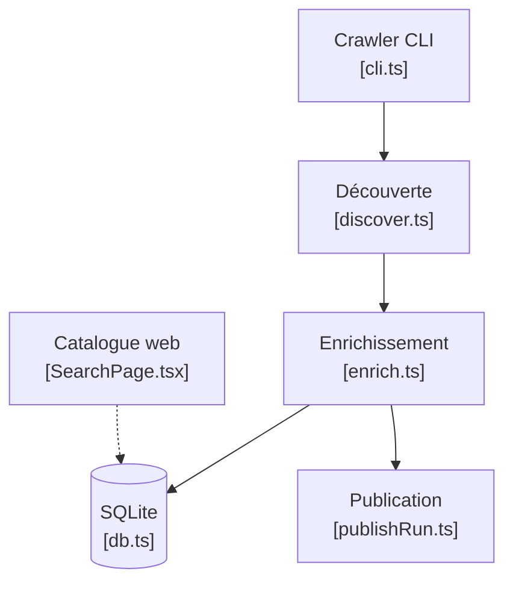

# quemsah/awesome-claude-plugins

> Ranking of the hundred most-starred GitHub repositories containing Claude Code plugins, updated automatically.

## The problem
Finding the Claude Code plugins that matter among tens of thousands of repositories means digging through GitHub by hand.

## What it actually does
A crawler discovers repositories, enriches them via the GitHub API, tracks its runs in a SQLite database, validates and then publishes a snapshot. The README displays the table of the top hundred (stars, watchers, number of plugins) out of 54,236 indexed repositories. A web catalog allows searching.

## How it is wired

## Trying it
No command documented in the README: just read the table.

## Cost and gotchas
Free. The ranking is by stars, not by quality: the list also contains general-purpose repositories such as next.js or storybook.

## What it is not
It is not a vetted selection nor an official directory. No license is declared on the repository.

## Alternatives
- claude-plugins-official: directory managed by Anthropic, present in the ranking.

## For you
Worth watching: handy for quickly spotting skills and plugins to pick up, but the popularity-based sorting means you must check each repository yourself.
