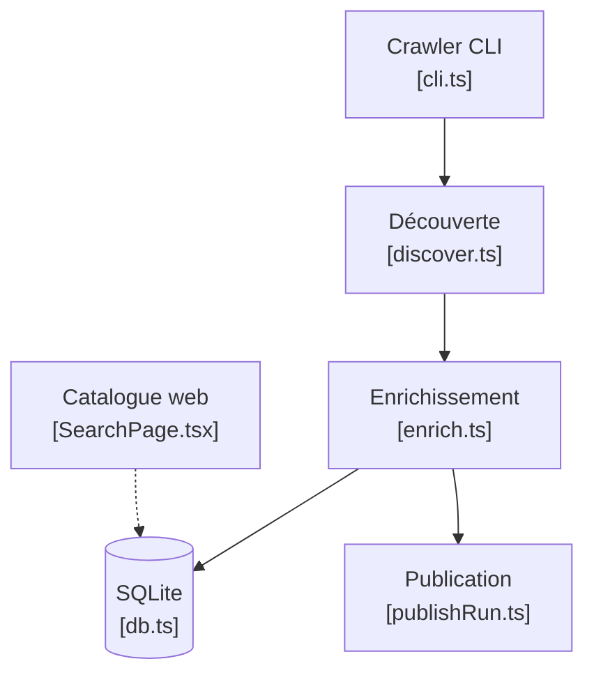

# quemsah/awesome-claude-plugins

> Classement des cent dépôts GitHub les plus étoilés contenant des plugins Claude Code, mis à jour automatiquement.

## Le problème
Trouver les plugins Claude Code qui comptent parmi des dizaines de milliers de dépôts demande de fouiller GitHub à la main.

## Ce que ça fait vraiment
Un robot d'indexation découvre les dépôts, les enrichit via l'API GitHub, suit ses exécutions en base SQLite, valide puis publie un instantané. Le README affiche le tableau des cent premiers (étoiles, observateurs, nombre de plugins) sur 54 236 dépôts indexés. Un catalogue web permet la recherche.

## Comment c'est branché

## Essayer
Aucune commande documentée dans le README : il suffit de lire le tableau.

## Coût et pièges
Gratuit. Le classement est par étoiles, pas par qualité : la liste contient aussi des dépôts généralistes comme next.js ou storybook.

## Ce que ce n'est pas
Ce n'est pas une sélection vérifiée ni un annuaire officiel. Aucune licence n'est déclarée sur le dépôt.

## Alternatives
- claude-plugins-official : répertoire géré par Anthropic, présent dans le classement.

## Pour toi
À surveiller : pratique pour repérer vite des skills et plugins à récupérer, mais le tri par popularité demande de vérifier chaque dépôt toi-même.

