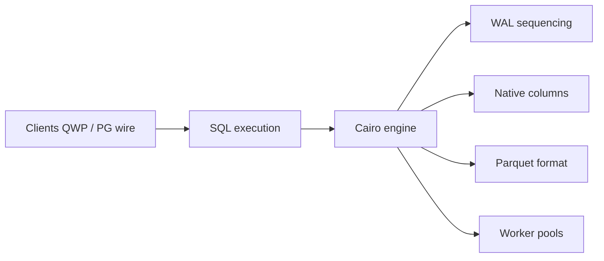

# questdb/questdb

> Low-latency time-series database, massive ingestion and SQL queries over Parquet.

## The problem
Ingesting millions of events per second and querying them both live and historically is beyond general-purpose databases.

## What it actually does
GC-free Java engine with C++ and Rust on hot paths; memory-mapped columns partitioned by time; JIT filters, SIMD. Layered storage: WAL, native partitions, Parquet. Extended SQL (`SAMPLE BY`, `LATEST ON`, `ASOF JOIN`), materialized views, deduplication. Binary QWP protocol (Arrow write and read), PostgreSQL wire, ILP, REST, web console. Python, Go, Rust, Java, .NET, C/C++ clients; skills and MCP server for agents.

## How it is wired


## Trying it
```bash
docker run -p 9000:9000 -p 8812:8812 questdb/questdb
brew install questdb
questdb start
npx skills add questdb/skills
```

## Cost and gotchas
Free open source (Apache-2.0). Paid Enterprise: high availability, automatic tiering to Parquet, RBAC, SSO. Native libraries for Apple Silicon only (Docker on Intel Mac). Benchmarks provided by the vendor.

## What it is not
Not a general-purpose analytical warehouse. Replication and automatic tiering are reserved for the paid edition.

## Alternatives
InfluxDB, ClickHouse, TimescaleDB, kdb+ (comparisons in the README).

## For you
Excellent for telemetry, finance or IoT feeding models via Arrow, Pandas or Polars; adopt on a trial basis.
