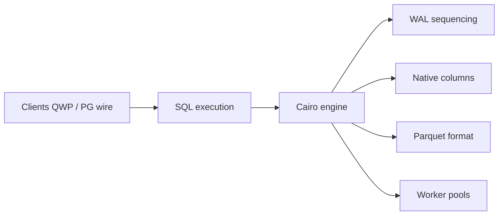

# questdb/questdb

> Base de données de séries temporelles à faible latence, ingestion massive et requêtes SQL sur Parquet.

## Le problème
Ingérer des millions d'événements par seconde et les interroger en direct comme en historique dépasse les bases généralistes.

## Ce que ça fait vraiment
Moteur Java sans GC avec C++ et Rust sur les chemins chauds ; colonnes mappées en mémoire partitionnées par temps ; filtres JIT, SIMD. Stockage en couches : WAL, partitions natives, Parquet. SQL étendu (`SAMPLE BY`, `LATEST ON`, `ASOF JOIN`), vues matérialisées, déduplication. Protocole QWP binaire (écriture et lecture Arrow), PostgreSQL wire, ILP, REST, console web. Clients Python, Go, Rust, Java, .NET, C/C++ ; skills et serveur MCP pour agents.

## Comment c'est branché


## Essayer
```bash
docker run -p 9000:9000 -p 8812:8812 questdb/questdb
brew install questdb
questdb start
npx skills add questdb/skills
```

## Coût et pièges
Open source gratuit (Apache-2.0). Enterprise payant : haute disponibilité, tiering automatique vers Parquet, RBAC, SSO. Bibliothèques natives pour Apple Silicon seulement (Docker sur Mac Intel). Benchmarks fournis par l'éditeur.

## Ce que ce n'est pas
Pas un entrepôt analytique généraliste. La réplication et le tiering automatique sont réservés à l'édition payante.

## Alternatives
InfluxDB, ClickHouse, TimescaleDB, kdb+ (comparaisons du README).

## Pour toi
Excellent pour télémétrie, finance ou IoT en entrée de modèles via Arrow, Pandas ou Polars ; à adopter en essai.

