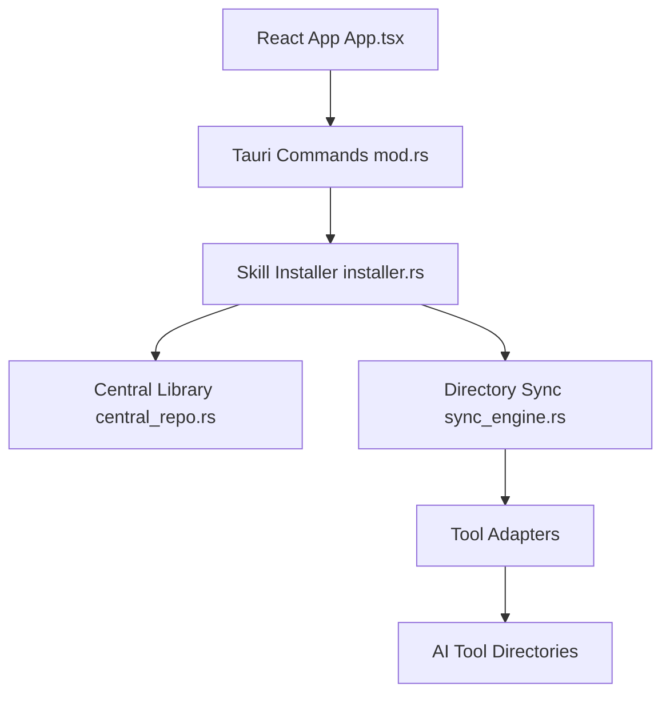

# qufei1993/skills-hub

> A desktop application that installs your agent skills once and syncs them to every tool.

## The problem
Agent skills are copied by hand into each coding tool's folder, then drift apart from one project and one machine to another.

## What it actually does
The Tauri application (React and Rust) keeps a central library of skills, imported from a Git repository, a local folder or collections. It syncs them to the global or project folders of the chosen tools, and handles tags, scheduled updates, a trash bin and cross-device sync through GitHub, GitLab or Gitee.

## How it is wired
Diagram taken from the code, simplified.



## Trying it
The README gives no command: download from the official page, then "Add Skills" in the application.

```bash
# non documenté dans le README : application graphique à télécharger
```

## Cost and gotchas
Free (MIT). AI-assisted management is enabled in the settings without Node.js. On macOS, the application may be flagged as damaged: an installation help page exists.

## What it is not
Not a source of skills: the collections come from a separate repository (Awesome Skills). Version 1.1.0 (projects, presets) is not yet released.

## Alternatives
No alternative named in the README.

## For you
Worth watching: useful if you manage several agent tools and many skills, at the risk of one more manager to maintain for little gain if you only have a few.
