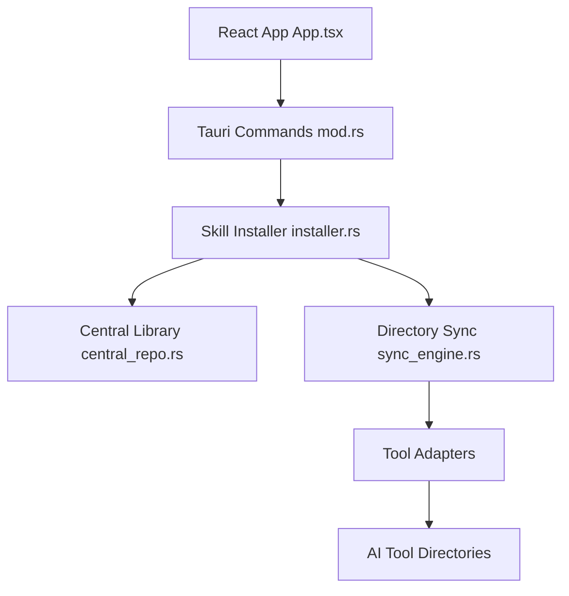

# qufei1993/skills-hub

> Une application de bureau qui installe tes skills d'agents une fois et les synchronise vers chaque outil.

## Le problème
Les skills d'agents sont copiés à la main dans le dossier de chaque outil de code, puis divergent d'un projet et d'une machine à l'autre.

## Ce que ça fait vraiment
L'application Tauri (React et Rust) garde une bibliothèque centrale de skills, importés depuis un dépôt Git, un dossier local ou des collections. Elle les synchronise vers les dossiers globaux ou de projet des outils choisis, gère tags, mises à jour planifiées, corbeille et synchronisation entre appareils via GitHub, GitLab ou Gitee.

## Comment c'est branché
Diagramme tiré du code, simplifié.



## Essayer
Le README ne donne aucune commande : téléchargement depuis la page officielle, puis « Add Skills » dans l'application.

```bash
# non documenté dans le README : application graphique à télécharger
```

## Coût et pièges
Gratuit (MIT). La gestion par IA s'active dans les réglages sans Node.js. Sur macOS, l'application peut être signalée comme endommagée : une aide d'installation existe.

## Ce que ce n'est pas
Pas une source de skills : les collections viennent d'un dépôt séparé (Awesome Skills). La version 1.1.0 (projets, presets) n'est pas encore publiée.

## Alternatives
Aucune alternative nommée dans le README.

## Pour toi
À surveiller : utile si tu gères plusieurs outils d'agents et beaucoup de skills, au risque d'un gestionnaire de plus à maintenir pour peu de gain si tu n'en as que quelques-uns.

